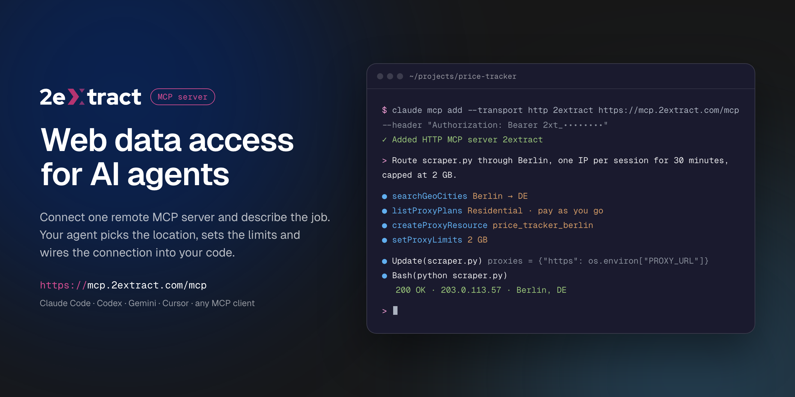

# 2extract MCP Server



Remote [Model Context Protocol](https://modelcontextprotocol.io) server for [2extract](https://2extract.com). It lets an AI agent create and manage residential and mobile proxies, pick geo targeting down to city, ZIP or carrier, set traffic and spend limits, and report on usage and cost.

This is a hosted server. There is nothing to install or run locally: your MCP client connects to the URL below with your 2extract API key.

| | |
|---|---|
| Endpoint | `https://mcp.2extract.com/mcp` |
| Transport | Streamable HTTP |
| Auth | `Authorization: Bearer 2xt_...` (2extract API key) |

## Get an API key

1. [Sign up](https://2extract.com/app/signup) or log in to 2extract.
2. Open [API keys](https://2extract.com/app/api-keys) and create a key.
3. Grant the scopes the agent needs: `proxies:read`, `proxies:write`, `balance:read`, `stats:read`, `geo:read`. Write scopes do not include read access, so most workflows need both `proxies:read` and `proxies:write`.

A read-only key (no `proxies:write`) is enough for reporting and lookups.

## Connect

### Claude Code

```bash
claude mcp add --transport http 2extract https://mcp.2extract.com/mcp \
  --header "Authorization: Bearer 2xt_your_api_key"
```

### Codex CLI

The key is read from the `EXTRACT_API_KEY` environment variable; Codex adds `Bearer` itself:

```bash
export EXTRACT_API_KEY=2xt_your_api_key
codex mcp add 2extract --url https://mcp.2extract.com/mcp --bearer-token-env-var EXTRACT_API_KEY
```

Or edit `~/.codex/config.toml` (or `.codex/config.toml` in a trusted project):

```toml
[mcp_servers.2extract]
url = "https://mcp.2extract.com/mcp"
bearer_token_env_var = "EXTRACT_API_KEY"
```

### Gemini CLI

```bash
gemini mcp add -s user --transport http \
  --header "Authorization: Bearer 2xt_your_api_key" \
  2extract https://mcp.2extract.com/mcp
```

Or edit `~/.gemini/settings.json` (or `.gemini/settings.json` in a project):

```json
{
  "mcpServers": {
    "2extract": {
      "httpUrl": "https://mcp.2extract.com/mcp",
      "headers": { "Authorization": "Bearer 2xt_your_api_key" }
    }
  }
}
```

### OpenCode

`opencode.json` in your project (or `~/.config/opencode/opencode.json`). The key is read from the `EXTRACT_API_KEY` environment variable:

```json
{
  "$schema": "https://opencode.ai/config.json",
  "mcp": {
    "2extract": {
      "type": "remote",
      "url": "https://mcp.2extract.com/mcp",
      "enabled": true,
      "headers": { "Authorization": "Bearer {env:EXTRACT_API_KEY}" }
    }
  }
}
```

### Claude Desktop

`claude_desktop_config.json`:

```json
{
  "mcpServers": {
    "2extract": {
      "type": "http",
      "url": "https://mcp.2extract.com/mcp",
      "headers": { "Authorization": "Bearer 2xt_your_api_key" }
    }
  }
}
```

### Cursor

`~/.cursor/mcp.json` or `.cursor/mcp.json`:

```json
{
  "mcpServers": {
    "2extract": {
      "url": "https://mcp.2extract.com/mcp",
      "headers": { "Authorization": "Bearer 2xt_your_api_key" }
    }
  }
}
```

### VS Code

`.vscode/mcp.json` (the key is requested on first use and not stored in the file):

```json
{
  "inputs": [
    {
      "type": "promptString",
      "id": "2extract-api-key",
      "description": "2extract API key",
      "password": true
    }
  ],
  "servers": {
    "2extract": {
      "type": "http",
      "url": "https://mcp.2extract.com/mcp",
      "headers": { "Authorization": "Bearer ${input:2extract-api-key}" }
    }
  }
}
```

### Cline

Open the Cline panel, click **MCP Servers**, then **Configure MCP Servers**, and add to `cline_mcp_settings.json`:

```json
{
  "mcpServers": {
    "2extract": {
      "type": "streamableHttp",
      "url": "https://mcp.2extract.com/mcp",
      "headers": { "Authorization": "Bearer 2xt_your_api_key" },
      "disabled": false
    }
  }
}
```

Keep `"type": "streamableHttp"`: without it Cline falls back to the older SSE transport.

### Other clients

Any client that supports remote MCP servers works. Give it the endpoint URL, the Streamable HTTP transport and the `Authorization` header.

## Tools

### Account

| Tool | What it does | Scope |
|---|---|---|
| `getAccountBalance` | Available funds, whether a new proxy can be created, and the proxy username prefix | `balance:read` |
| `getAccountTrafficUsage` | Traffic and spend over a period, for the account or one proxy | `stats:read` |
| `listAccountBalanceHistory` | Deposits and charges over a period | `stats:read` |

### Geo targeting

| Tool | What it does | Scope |
|---|---|---|
| `listGeoCountries` | Countries available for targeting | `geo:read` |
| `searchGeoRegions` | Regions and states within a country | `geo:read` |
| `searchGeoCities` | Cities within a country or region | `geo:read` |
| `searchGeoZips` | ZIP and postal codes within a country | `geo:read` |
| `searchGeoISP` | Mobile carriers for ISP targeting | `geo:read` |

### Plans

| Tool | What it does | Scope |
|---|---|---|
| `listProxyPlans` | Available plans and their prices | `proxies:read` |

### Proxies

| Tool | What it does | Scope |
|---|---|---|
| `listProxyResources` | Every proxy on the account, with traffic and spend | `proxies:read` |
| `getProxyResource` | Full detail for one proxy | `proxies:read` |
| `createProxyResource` | Create a proxy (billable) | `proxies:write` |
| `updateProxyResource` | Change description, status, geo, whitelist or limits | `proxies:write` |
| `deactivateProxyResource` | Stop traffic without deleting the proxy | `proxies:write` |
| `deleteProxyResource` | Permanently remove a proxy (asks for confirmation) | `proxies:write` |
| `regenerateProxyPassword` | Issue a new password (asks for confirmation) | `proxies:write` |
| `setProxyLimits` | Cap traffic or spend per day or month | `proxies:write` |
| `setProxyIpWhitelist` | Restrict which IP addresses can use the proxy | `proxies:write` |
| `setProxyTargetHosts` | Restrict which domains the proxy can reach (wildcards like `*.example.com`) | `proxies:write` |

Confirmation for destructive tools happens in your client. If the client does not ask, any key with `proxies:write` can run them, so scope keys accordingly.

## Prompts

| Prompt | Arguments | What it does |
|---|---|---|
| `create-proxy-resource` | `purpose`, `proxy_type`?, `country`? | Creates a proxy for a stated job and returns a connection string |
| `build-connection-string` | `proxy_id`?, `purpose`? | Builds a connection string for an existing proxy |
| `monthly-cost-report` | `period` | Traffic and spend per proxy for a period, with outliers flagged. Read-only |
| `cleanup-unused-proxies` | none | Finds proxies with no traffic in 30 days and deactivates them after you confirm. Never deletes |

## Example requests

- "Create a residential proxy in Germany, Berlin, for price monitoring, capped at 5 GB a month."
- "Give me a sticky-session connection string for my `serp_us` proxy."
- "How much did I spend on traffic last month, per proxy?"
- "Which proxies had no traffic in the last 30 days? Deactivate them."
- "Find mobile carriers in the US I can target."

## Documentation

- [MCP server overview](https://docs.2extract.com/ai/mcp-server/overview)
- [Quick start](https://docs.2extract.com/ai/mcp-server/quick-start)
- [Tools reference](https://docs.2extract.com/ai/mcp-server/tools)
- [Prompts](https://docs.2extract.com/ai/mcp-server/prompts)
- [Usage examples](https://docs.2extract.com/ai/mcp-server/usage-examples)
- [FAQ](https://docs.2extract.com/ai/mcp-server/faq)
- [Connection page](https://mcp.2extract.com/)

## Support

- Email: support@2extract.com
- Issues with this listing: open an issue in this repository

## Legal

- [Terms of Service](https://2extract.com/terms)
- [Privacy Policy](https://2extract.com/privacy)

The server source code is not published. This repository holds the public listing, client configuration examples and the registry manifest (`server.json`).
